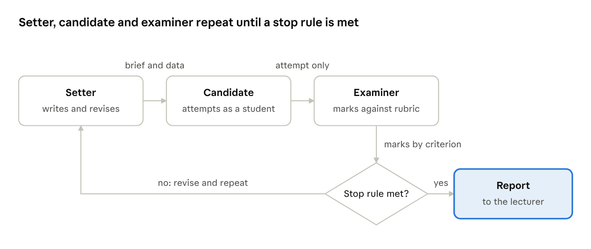

# From assistant to agent: a worked example

An assessment can be tested by three agents, one that sets it, one that sits it and one that marks it, in a cycle that repeats until a stopping rule set in advance is met. It is the only system in the handbook in which the software decides its own next step.

**Assistant or agent.** In chapters 5 to 9 you set each task, approve the plan and fix the steps in advance. The work is therefore supervised. An agent in the stricter sense is given a goal and a stopping rule and chooses its own actions from what it observes. The stress test in chapter 7 is the manual version of this system.

**Separate roles.**

| Role | Sees | Produces | Must not see |
| --- | --- | --- | --- |
| Setter | Learning outcomes, constraints, the examiner's last report | The brief, data and rubric; a log of each change and its reason | The candidate's working |
| Candidate | Only what a student receives | A complete submission | The rubric's marking notes, the setter's intentions, earlier rounds |
| Examiner | The submission and the rubric | A mark per criterion with a one-line justification | Who or what wrote the submission |

The design depends on this separation, because a candidate that has seen the marking notes, or an examiner that knows the submission is machine-written, gives no information about the assessment.

**One round.**

1. The setter writes or revises the assessment and records what changed and why.
2. The candidate attempts it in a clean folder with only the student-facing files.
3. The examiner marks the attempt against the rubric, criterion by criterion.
4. The system checks the stopping rule.
5. If it is not met, the setter reads the examiner's report, identifies the criteria the candidate passed most easily, and revises.

Each pass runs left to right; an unmet stopping rule sends the examiner's report back to the setter.

**The stopping rule.** Set it before the first round. For example: stop when the candidate's mark falls below 50, or after five rounds, or when the setter cannot propose a change that respects the constraints. The third condition matters because some assessments cannot be made robust in their current format, and a report that says so is a useful result.

**Constraints on the setter.** Without them the loop converges on an assessment that defeats the candidate and is worthless for students. State them as rules the setter must satisfy in every round:

- Every learning outcome assessed in the original is still assessed.
- The format, weighting, word limit and time allowance are unchanged unless you allow otherwise.
- A well-prepared student can complete it in the time given, using only what the module taught.
- No change relies on obscurity, trick wording or information students cannot reasonably obtain.
- Each change is logged with the criterion it targets.

The changes left open by these constraints mostly tie the task to something the candidate does not have: work done in class, data the student collects, a position defended orally, or a judgement that must be justified against material specific to the module.

**The report.** It gives the original and final versions side by side, the change log, the mark by criterion in every round, the final attempt in full, and the setter's own assessment of which constraints came under strain.

**The lecturer's part.**

- **Mark the final attempt yourself.** The examiner is a language model, and chapter 8 documents how such marks are compressed towards the middle. Its marks steer the loop but are not evidence that the assessment is safe.
- **Judge validity.** Read the final version as a student would, and check that it is still a valid test of the learning outcomes and not only a harder one.
- **Check the examiner once.** Before trusting the loop, give the examiner two or three model answers you have written at known standards and see whether it ranks them correctly. Do not use real student scripts for this unless your university permits it (chapter 10).

**Limits.**

- The candidate models a capable student using a current tool with little effort, which is the case the assessment has to withstand, and says nothing about how real students at different levels will perform.
- The result is specific to the tool and the date. Record both and rerun each year.
- A full run uses many times the computation of a single request. Start with a round limit of three.
- This system has not been run on a live module. Treat the files in [template H](templates.qmd#tpl-h) as a starting design.

**Other uses of the same three roles.** For an invigilated exam, where AI use is not the concern, the loop still improves quality, because the candidate reports ambiguous wording and questions it could not finish in the time, and the examiner reports where the marking scheme gave no guidance. The setter revises for clarity instead of robustness.

**By field.** For empirical coursework, give the candidate the dataset and let it run code. For a theory problem set, the examiner needs full worked solutions in addition to final answers. For essay-based modules, expect the examiner's marks to be least reliable, and rely more on your own marking of the final attempt.

> **In Claude Code.** The candidate and examiner are [subagents](https://code.claude.com/docs/en/sub-agents), each a file in `.claude/agents/` with its own instructions and tool list. Setting `omitClaudeMd: true` starts a subagent without the module instruction file, which the candidate needs. The main session plays the setter and runs the loop from a skill.
>
> A subagent in the same folder can still open files it is told not to. For a stricter test, copy the student-facing files to an empty folder outside the module and run the candidate there.
